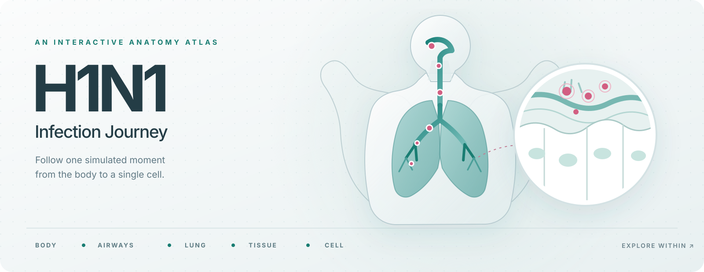

# H1N1 · Infection Journey

**Step inside an infection.** Explore a human anatomy atlas, follow H1N1 through the respiratory system, and zoom all the way into a single cell. Time is already moving when the page opens; every scale shows the same moment in the same simulated story.

This is an interactive educational illustration built with React, TypeScript, Vite and Three.js. It runs entirely in your browser using local 3D assets. No account, API, database or remote runtime service is required.

**Try the live simulation:** [h1n1.com.br](https://h1n1.com.br/)

## What you can explore

- **Five connected scales:** body → respiratory system → lung → tissue → cell. Rotate, pan, zoom, search and select structures without losing your place in time.
- **A person you can follow:** a persistent status strip shows the simulated body's stage, affected regions, viral activity, tissue integrity and possible symptoms in the illustration. These symptoms are narrative possibilities, not measured or predicted symptoms for a real person.
- **A living timeline:** pause, replay or move to any hour across 14 or 21 simulated days. New milestones appear as small notices and collect in a navigable roadmap. Select any reached card to return to its hour and region in 3D.
- **Your own scenario:** increase the model's viral pace from 1× to 3×, add conditions such as sleep loss or airway irritation, and compare scenario B with the untouched original scenario A.
- **Full anatomy when you want it:** the default view follows H1N1. You can also open the wider Human Atlas, search its structures, isolate a part or explore its anatomical layers.

The simulation uses seeded, deterministic rules over five connected respiratory regions. It tracks cellular exposure, infection, defense, damage, removal and replacement. Its indices and particles are illustrative model outputs, **not clinical measurements or forecasts**.

## Run it locally

You need **Node.js 22 or newer** and **pnpm 12.6.0**. From the repository root:

```sh
pnpm install
pnpm dev
```

Open **http://127.0.0.1:3000**. To serve the optimized production build locally:

```sh
pnpm build
pnpm start
```

The build is written to `apps/simulator/dist`. The preview uses port 3000 and stays on your computer. No environment variables are needed.

## English and Portuguese

The interface follows your browser's primary language. A browser set to Portuguese displays **Português**; every other language uses **English**. English is the default. The page title, accessible labels, controls, explanations, atlas panels and simulation messages follow the same setting.

For a local language check, add `?lang=en` or `?lang=pt` to the preview URL. This explicit URL choice overrides the browser language for that visit. It does not change the simulation's seed or outcomes.

## How it works

| Area | Responsibility |
| --- | --- |
| `apps/simulator/src/engine/journey/` | Seeded hourly simulation, regional state, events, snapshots and A/B branches |
| `apps/simulator/src/atlas/` | Human Atlas anatomy, structure search, H1N1 path and 3D camera controls |
| `apps/simulator/src/graphics/journey/` | Tissue and cell scenes, animation and graphics resource cleanup |
| `apps/simulator/src/journey/` | Shared timeline, anatomy registry and simulated-person narrative |
| `apps/simulator/src/components/journey/` | Controls, status, milestones, comparisons and charts |
| `apps/simulator/src/i18n.ts` | Browser language selection and English/Portuguese presentation |

One shared clock drives the atlas and microscopic scenes. Biological changes come from the model, while animations use the same simulated hour so pause and replay return to the same visual state. The app bounds representative particles and releases graphics resources when changing scales.

## Verify a change

```sh
pnpm typecheck
pnpm test
pnpm build
```

Browser interaction during project validation uses the authorized Codex browser extension. The browser auditor in `apps/simulator/scripts/validate-atlas-browser.mjs` accepts that integration's browser handles; it does not start or attach a separate browser.

## Contribute

Ideas, bug reports and focused pull requests are welcome. Read the [contribution guide](CONTRIBUTING.md) for setup, project conventions, bilingual copy and the checks expected before review.

The project's original code and documentation are available under the [MIT License](LICENSE). Anatomical models and adapted third-party code retain their own terms; see the [third-party notices](THIRD_PARTY_NOTICES.md).

## Anatomy credits and project scope

The macroscopic atlas adapts the open source [Human Atlas](apps/simulator/public/models/atlas/ATTRIBUTION.md) and includes BodyParts3D anatomy. The respiratory view also uses local lung structures from the Human Reference Atlas. Licenses, sources and adaptation notes are in [Anatomy assets](docs/ANATOMY_ASSETS.md) and the [distributed model credits](apps/simulator/public/models/ATTRIBUTION.md).

`apps/simulator` is the active product. The older Next.js site, API, data packages and first microscopic prototype remain in the repository as historical source; root development commands target the simulator. Development and local previews require no cloud service. This repository is not registered with or hosted on OpenAI cloud, ChatGPT Sites or related services.

For implementation details, see the [design system](docs/DESIGN_SYSTEM.md) and [validation notes](docs/SIMULATOR_VALIDATION.md).
